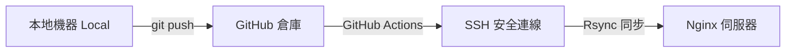

---
{"tags":["devops","git","github-actions","nginx","server"],"created":"2026-11-18T19:17:01.387+08:00","status":"completed","dg-publish":true,"permalink":"/02領域/linux/github_to_nginx_sync_manual/","dgPassFrontmatter":true,"noteIcon":"","updated":"2026-11-19T15:19:37.917+08:00","dg-note-properties":{"tags":["devops","git","github-actions","nginx","server"],"created":"2026-11-18","status":"completed"}}
---


# GitHub 儲存庫同步至 Nginx 伺服器操作手冊

本手冊旨在指導如何設定自動化流程：當開發者將程式碼推送到 GitHub 儲存庫 (`git push`) 時，透過 GitHub Actions 與 SSH 機制，自動將最新程式碼同步更新至 Hetzner（或任何 Nginx）伺服器的指定網站根目錄中。

---

## 📋 系統架構總覽



1. **本機 (Local Machine)**：撰寫與修改程式碼，透過 Git 推送到 GitHub。
2. **遠端倉庫 (GitHub Repository)**：存放程式碼並作為 CI/CD 自動化的觸發核心。
3. **自動化流程 (GitHub Actions)**：透過 SSH 安全連線至伺服器。
4. **目標伺服器 (Hetzner / Nginx)**：接收同步檔案並透過 Nginx 即時對外提供網頁服務。

---

## 🛠️ 第一階段：伺服器端 SSH 金鑰設定

為了讓 GitHub Actions 能夠安全且免密碼地登入你的 Nginx 伺服器，我們必須建立專用的 SSH 部署金鑰。

### 1. 在本機終端機產生 SSH 金鑰對

打開終端機，執行以下指令（可將 `github-actions-deploy` 替換為你喜歡的識別名稱）：

```bash
ssh-keygen -t ed25519 -C "github-actions-deploy" -f ~/.ssh/gh_deploy
```

> [!NOTE] 提示
> 過程中若詢問 `Passphrase` 直接按 `Enter` 略過即可。

執行後會在 `~/.ssh/` 目錄下產生兩支檔案：
* `gh_deploy` （私鑰 - Private Key，**絕對不能外洩**）
* `gh_deploy.pub` （公鑰 - Public Key）

### 2. 將公鑰部署至伺服器

1. 印出公鑰內容並複製：
   ```bash
   cat ~/.ssh/gh_deploy.pub
   ```
2. 透過 SSH 登入你的伺服器：
   ```bash
   ssh root@你的伺服器IP
   ```
3. 將剛剛複製的公鑰貼到伺服器的 `/root/.ssh/authorized_keys` 檔案最下方並儲存。
4. 確保資料夾與檔案權限正確：
   ```bash
   chmod 700 /root/.ssh
   chmod 600 /root/.ssh/authorized_keys
   ```

---

## 🔒 第二階段：設定 GitHub Repository Secrets

GitHub Actions 需要透過加密變數來取得伺服器連線資訊。

1. 用瀏覽器登入 GitHub，進入你的專案儲存庫（例如 `gavintux/yi`）。
2. 點擊上方的 **Settings**（設定）分頁。
3. 在左側選單找到 **Secrets and variables** > 點擊 **Actions**。
4. 點擊 **New repository secret**，依序新增以下三個秘密變數：

| Secret 名稱 | 內容說明 |
| :--- | :--- |
| `SERVER_HOST` | 你的伺服器 IP 位址（例如 `95.217.152.250`） |
| `SERVER_USER` | 伺服器登入帳號（通常為 `root`） |
| `SSH_PRIVATE_KEY` | 本機產生的 **私鑰** 內容 (`cat ~/.ssh/gh_deploy` 的完整文字，包含 `-----BEGIN...-----`) |

---

## ⚙️ 第三階段：建立 GitHub Actions 自動化腳本

在你的專案根目錄下建立 `.github/workflows/deploy.yml` 檔案，內容如下：

```yaml
name: Deploy to Hetzner Nginx Server

on:
  push:
    branches: [ main ] # 當推送到 main 分支時觸發

jobs:
  deploy:
    runs-on: ubuntu-latest

    steps:
    - name: Checkout code
      uses: actions/checkout@v4

    - name: Setup SSH Key
      uses: webfactory/ssh-agent@v0.9.0
      with:
        ssh-private-key: ${{ secrets.SSH_PRIVATE_KEY }}

    - name: Deploy to Server via SSH
      env:
        SERVER_HOST: ${{ secrets.SERVER_HOST }}
        SERVER_USER: ${{ secrets.SERVER_USER }}
      run: |
        # 略過第一次連線的 Host key 詢問
        mkdir -p ~/.ssh
        echo "StrictHostKeyChecking no" >> ~/.ssh/config

        # 使用 rsync 將專案檔案同步到 Nginx 網站根目錄
        # 請將 /var/www/html 替換為你伺服器上 Nginx 實際指向的網站資料夾路徑
        rsync -avz --delete ./ $SERVER_USER@$SERVER_HOST:/var/www/html/
```

---

## 🚀 第四階段：日常使用與驗證

當上述設定完成後，日後你只需要在本地修改程式碼，並執行標準的 Git 三部曲即可完成自動同步：

```bash
# 1. 將所有修改加入暫存區
git add .

# 2. 建立本地版本紀錄
git commit -m "更新網站前端程式碼"

# 3. 推送到 GitHub (會自動觸發 Actions 同步至 Nginx)
git push origin main
```

### 如何檢查同步狀態？

1. 回到 GitHub 專案頁面的 **Actions** 分頁。
2. 點擊最新的一次推送任務，觀察各個步驟是否出現綠色的 **Success** 標記。
3. 打開你的網頁瀏覽器，重新整理網站，即可看到最新的更新內容已在 Nginx 伺服器上生效。