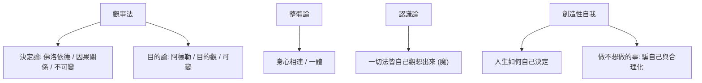
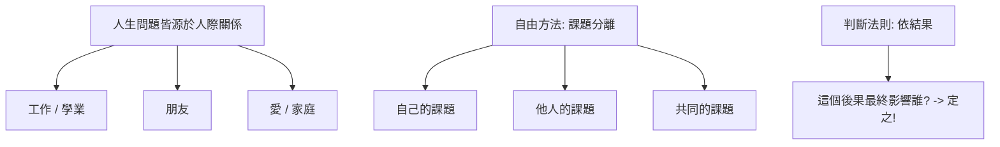
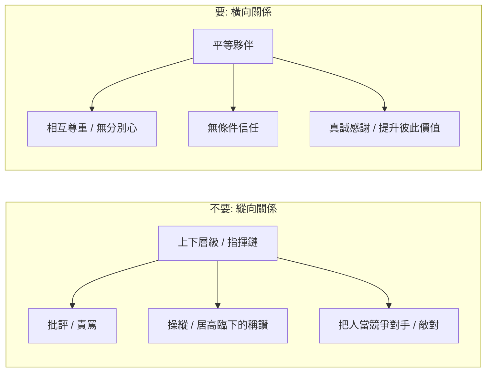
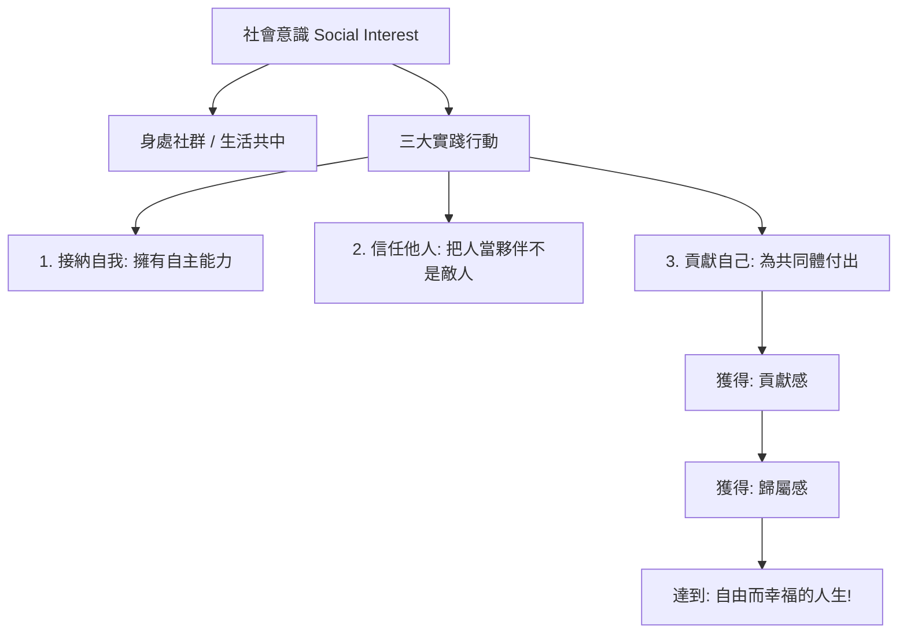

---
{"title":"《被討厭的勇氣》心智圖全解析：如何活出自由、自信又幸福的自己","categories":["[[Note]]"],"tags":["psychology","adler","reading","growth"],"status":"🌱","sourceType":"📥/📚","created":"2026-09-29T11:58:22.809+08:00","dg-publish":true,"permalink":"/Notes/被討厭的勇氣/","dgPassFrontmatter":true,"noteIcon":"","updated":"2026-09-30T20:31:51.743+08:00","dg-note-properties":{"title":"《被討厭的勇氣》心智圖全解析：如何活出自由、自信又幸福的自己","categories":["[[Note]]"],"tags":["psychology","adler","reading","growth"],"status":"🌱","sourceType":"📥/📚","created":"2026-09-29"}}
---

# 《被討厭的勇氣》：如何活出自由、自信又幸福的自己

你有沒有過這樣的感覺？
- 走在學校走廊上，總覺得別人在對你指指點點？
- 明明不想借筆記給別人，卻因為害怕被討厭而不敢說「不」？
- 考試考砸了，心裡沮喪地想：「我就不是讀書的料，我以前就這樣，以後一定也沒救了……」

如果你曾經有過這些煩惱，別擔心，這非常正常！當我們快要滿 12 歲、即將從小學邁向中學時，世界突然變大了，身邊的朋友、同儕和家長的期待也像一張網一樣罩過來。

大約一百年前，有一位非常厲害的心理學家叫**阿爾弗雷德·阿德勒（Alfred Adler）**。他的想法被寫成了一本超級暢銷書，叫做《被討厭的勇氣》。

這篇文章會用最輕鬆、好懂的語言，搭配我們在學校和家裡常遇到的生活故事，帶你走過這張「心智圖寶藏地圖」，把裡面的每一個重要觀念和秘密備註都挖出來。準備好了嗎？我們出發吧！

---

## 第一章：心智的超能力眼鏡——你看到的世界，由你決定！

你相信嗎？我們眼睛看到的世界，其實不是「外面的世界本來長怎樣」，而是我們「戴著什麼眼鏡在看它」。阿德勒心理學給了我們一副超級神奇的鏡片：

### 1. 決定論 vs. 目的論：你是被過去綁架，還是為了未來行動？

在心理學界，有兩位超級大師的觀點完全相反：
- **佛洛依德的「決定論」**：他認為人現在的樣子，都是被「過去的因果關係」決定的。事情一旦發生，就像刻在石頭上一樣**「不可變」**。
  - *決定論的想法*：「我小學三年級時在台上演講出過糗，大家都在笑我，所以我這輩子注定就是個不敢上台講話的人。」
- **阿德勒的「目的論」**：阿德勒大聲說：「才不是這樣呢！」人的行為是由未來的**「目的」**驅動的，你的未來永遠是**「可變」**的！
  - *目的論的想法*：「你不是因為過去出糗才不敢上台，而是你現在『不想承受再次緊張、害怕丟臉的感覺』（這是你的目的），所以你的大腦才製造出心跳加速和恐懼，幫你找藉口不上台！」

> 💡 **生活小例子**：
> 想像小明今天早上賴床遲到了，被老師罵了一頓。
> - **決定論思考**：「都怪昨天媽媽太晚叫我睡覺、鬧鐘又壞掉，所以我今天才會遲到，這不是我的錯，我今天一整天都毀了。」（把責任推給過去的因果，覺得自己無能為力）。
> - **目的論思考**：「我賴床是為了『想多睡舒服的十分鐘』（我的目的）。既然這是我自己的選擇，那我明天可以改變目的——我想要『從容吃早餐、準時到校』，所以我今天提早三十分鐘上床睡覺！」（自主性誕生，未來立刻改變！）。

**阿德勒的目的論三步驟（Why to do -> Then）：**
當你做任何事時，問問自己：
1. **思考（Why to do）**：我現在做這件事真正的「目的」是什麼？
2. **情緒**：不要讓生氣、害怕或沮喪牽著走，看清楚背後的目的。
3. **行動**：既然看清了目的，我就擁有「自主性」，能夠採取全新的行動來創造未來！

---

### 2. 整體論：你的大腦與身體是「一體」的好隊友

有時候我們會說：「我剛才不是故意罵人的，是我那一瞬間『脾氣爆發』，理智斷線了！」
阿德勒說：**人是一個不可分割的「整體」（Holism）**。心靈、身體、情緒不是分開的零件，而是身心相連的一體。

你不是被「憤怒的情緒」綁架了，而是你「為了想要用大聲音把別人嚇住、聽你的話」，身體才配合你握緊拳頭、心跳加速、大吼出聲。
當你明白「身心一體」，你就不會再拿「我脾氣不好」當藉口，因為情緒也是你為了達成某個目標所選用的工具。

---

### 3. 認識論：別在心裡養一隻自己嚇自己的「魔」

心智圖上有個耐人尋味的備註：**「認識論：一切法皆自己觀想出來（魔）」**。
這是什麼意思呢？
每個人對世界的認識都是主觀的。你眼中的現實，是你根據自己的想法和生活風格「塑造」出來的。

> 💡 **生活小例子**：
> 當你走進教室，看見兩個同學在小聲說話，轉頭看了你一眼就笑了。
> - 如果你在心裡養了一隻「自卑的心魔」，你的大腦就會自動觀想：「他們一定是在笑我的新髮型很蠢！大家都在嘲笑我！」於是你一整天都低著頭，心情低落。
> - 但如果摘下心魔的眼鏡，事實可能只是：「他們剛好聊到早上的搞笑漫畫，轉頭看見你，善意地微笑打招呼。」
> 
> 外面的風吹草動本來沒有惡意，往往是我們心裡的「魔」，把世界想像成充滿敵意的戰場。

---

### 4. 創造性自我：別再「騙自己」和「合理化」

阿德勒提出了一個非常酷的詞——**創造性自我（Creative Self）**。
這代表每個人都像一位握著畫筆的畫家，你的人生畫布要塗上什麼顏色，**完全由你自己決定**。

但我們常常會做不想做的事，然後開始：
- **騙自己**：「我不是不想念書，是剛好今天這本書太無聊。」
- **合理化**：「反正大家都在滑手機，那我滑一整個晚上也是正常的吧！」

阿德勒提醒我們：別再用藉口騙自己了！誠實面對自己的選擇，為自己的每一個決定負責，這才是真正的長大。

---

### 5. 「業」的秘密：記憶的累積，可以靠現在的選擇翻轉！

心智圖中特別提到：**「業（Karma）＝ 記憶的累積」**。
過去的經歷、習慣和記憶，確實會像存錢筒一樣累積在我們身上（有時候是不好的影響，比如以前養成偷懶的習慣、或者過去被嘲笑的陰影）。

但是，阿德勒與哲學的智慧告訴我們：
- 我們可以**「透過當下的選擇」**，化解過去不良記憶的影響！
- 當你今天決定做一個勇敢誠實的新選擇，這個選擇就成為了**「未來好結果（良果）的原因」**！
過去無法改變，但「此時此刻」的選擇，永遠在你手上。

---

## 第二章：自由的超級超能力——「課題分離」

如果問阿德勒心理學中最神奇的一把手術刀是什麼，那絕對是**「課題分離（Task Separation）」**！

### 1. 人生所有的煩惱，都來自「人際關係」

阿德勒說了一句震撼所有人的話：**「世界上所有的煩惱，都是人際關係的煩惱。」**
不管是功課壓力的「工作課題」、想交知心朋友的「交友課題」，還是與爸媽相處的「愛的課題」，我們煩惱的根源，往往都在於**「搞混了這是誰的事情」**。

---

### 2. 怎麼分辨是誰的課題？——「依結果、影響誰、定之！」

在心智圖中，有一條非常清晰的判斷公式：
👉 **「依結果，看最終影響誰，由誰承擔責任，定之！」**

> 💡 **經典生活大作戰：寫作業是誰的課題？**
> 很多家長每天晚上都在家裡河東獅吼：「快去寫功課！不要再摸了！」
> 我們來用阿德勒的公式切一切：
> - **如果不寫作業，明天在學校被處罰、考試考不好、學不到知識，這個結果最終由誰承擔？**
>   👉 答案：**小朋友自己**。
>   所以，「寫不寫作業」是**小朋友的課題**。
> - 那麼「看見小孩不寫作業而感到焦慮生氣」，是誰的情緒？
>   👉 答案：**爸爸媽媽的課題**。
> 
> 當爸媽強行逼迫你，就是「干涉了你的課題」；而當你任性地說「都是你們逼我我才不要寫」，就是把自己的責任丟給了別人。
> 
> 真正成熟的做法是：雙方分清楚邊界，父母給予支持與環境（提供共同商討的空間），而小朋友自己承擔起學習的責任！

---

### 3. 不刻意討好別人——不怕被討厭，才是自由！

許多 12 歲的孩子，常常為了「想被班上受歡迎的小圈圈接納」，委屈自己去做不想做的事，比如跟著一起嘲笑別人，或是把自己心愛的玩具拱手借人。

心智圖告訴我們：
- **不刻意討好別人**：討好別人並不能換來真正的朋友，只會讓你失去自我。
- **課題分離容易令人討厭？**：沒錯！當你勇敢劃清界線、堅持做對的事情時，有些人可能會不高興、甚至說你的閒話。
- 但阿德勒說：**「被某個人討厭，正是你自由生活的證據！」**
  只要你沒有做傷害別人的事，別人喜不喜歡你、欣不欣賞你，那是**「別人的課題」**，你根本無法操控，也不需要去操控！

---

### 4. 成為一個真正善變的高手：善變的三種智慧

心智圖中特別提到了一個有趣的詞：**「善變」**。這裡的善變不是說話不算話，而是面對不斷變化的環境，擁有三種強大的能力：
1. **勇於面對**：遇到困難時不當縮頭烏龜，敢於直面挑戰。
2. **慧於分辨**：用智慧看清楚什麼是自己能控制的、什麼是自己不能控制的（課題分離）。
3. **戒簡而定**：生活簡約有紀律，內心安定，不被外界的混亂帶走步調。

---

## 第三章：從「分高低」到「並肩走」——人際關係的魔法

在班級裡，我們常常看到兩種人際關係模式，心智圖特別用「非（不要）」和「是（要）」做出了強烈的對比：

### 1. 什麼是「縱向關係」？（心智圖備註詳解）

> **心智圖特別備註**：
> 「縱向關係」指的是沿著垂直方向（上下方向）建立的關係，用來描述層級、指揮鏈或上下級。例如企業中經理與下屬的關係。

在學校裡，有些人喜歡建立「縱向關係」：
- **居高臨下**：用「我是班長/我成績好，所以你們都要聽我的」來指揮別人。
- **批評與操縱**：看別人做不好就諷刺嘲笑。
- **居高臨下的誇獎**：甚至連有些誇獎也是縱向的，比如「你表現得不錯，我很滿意」（這其實暗含著把自己放在比對方高的評判位置）。
- **把同學當敵人**：在這種關係裡，別人考高分就是我的威脅，同學之間變成了彼此防備的「競爭對手」。

### 2. 什麼是「橫向關係」？（雖不同，但平等）

阿德勒大力提倡**「橫向關係」**：
- 人與人之間雖然年齡不同、能力不同、角色不同，但**在人格上是絕對平等的**！
- 我們不是上下級，而是並肩作戰的**「夥伴（Partner）」**，**絕不是敵人**！

### 3. 信任、尊重與無分別心

心智圖上的關係線清楚標示：
- **「信任」等同於「尊重」！**
- **「尊重」會帶領我們走向「無分別心」！**

什麼是「無分別心」？就是不因為一個同學家裡有沒有錢、長得高矮、功課好壞，就用不同的眼光對待他。
尊重他作為一個獨一無二的人，給予他無條件的信賴。

### 4. 「感謝」的驚人魔法：提升彼此的個人價值！

心智圖中有一條重要的關係線：**【感謝】 ---> 【個人價值】（關係：提升）**。

當同學幫你撿起掉在地上的筆，或者幫你推開沉重的玻璃門時：
- 縱向關係的人可能會說：「做得好，賞你一顆糖！」（高高在上的評價）。
- **橫向關係的夥伴會真誠地說：「謝謝你，有你幫忙真好！」**

為什麼「謝謝」這麼神奇？
因為當我們聽到一句真誠的「謝謝」，我們內心會深深感受到：**「哇！我對別人是有用的！我是有價值的！」**
一句簡單的感謝，能瞬間點亮對方的自我價值感，也讓彼此的心貼得更近。

---

## 第四章：通往幸福的終極地圖——「社會意識」與「貢獻感」

我們讀書、生活、交朋友，最終是為了什麼？
阿德勒給出了一個最美妙的答案：**自由而幸福！**
而通往幸福的最高秘密，就是心智圖的核心：**社會意識（Social Interest / 共同體感覺）**。

### 1. 什麼是「社會意識」？

社會意識是指：**我們能夠把別人看作夥伴，感覺自己是家庭、班級、學校乃至全人類這個「共同體」的一份子，並打從心底關懷他人。**
心智圖備註說得一針見血：**「人生問題皆源於此」**——當你覺得世界孤立無援、身邊全是敵人時，你就會陷入痛苦；但當你建立起社會意識，所有的孤單都會煙消雲散。

### 2. 實踐幸福的三大行動步奏（Action Steps）

要怎麼在每天的校園和家庭生活中做到呢？心智圖給了我們三個具體步驟：

#### ① 接納自我（Self-Acceptance）
- 不是盲目自大說「我是完美的萬人迷」，而是誠實接受自己現在的模樣：「雖然我數學不太好，跑得也不快，但我就是獨一無二的我，我擁有學習和改變的**自主能力**！」
- 接受真實的自己，才能把精力用在能改善的事情上。

#### ② 信任他人（Trust in Others）
- 不預設別人會害你，而是把同學、家人當作共同前進的**夥伴**。
- 就算偶爾有人誤解你，那是對方的課題，你依然保持願意信任別人的寬廣胸懷。

#### ③ 貢獻他人（Social Contribution）
- 思考「我能為班上做什麼？」「我能為家裡幫什麼忙？」。
- **重點在於「去做」！**
  不用等做了驚天動地的大事才叫貢獻，在地上看到紙屑彎腰撿起來、在同學沮喪時遞上一張紙巾、回家主動盛一碗飯給家人，都是美好的貢獻。

---

### 3. 幸福的真理：貢獻感 ＝ 幸福！

心智圖上的最終連線：
👉 **【自由而幸福】 ---> 【貢獻感】**
👉 **【得到】 ---> 【歸屬感】**

當你為他人付出時，你不需要別人拍手誇獎你（因為追求別人的認同，又會掉進討好別人的陷阱）。
只要在心裡知道：**「我對身邊的人是有價值的！」**
這種打從心底湧現的**「貢獻感」**，就是幸福的本質。

當你擁有了貢獻感，你就會深深感到自己被社群所接納，獲得最踏實的**「歸屬感」**。
這時候，你既不需要討好任何人，也不再害怕任何人的眼光——你已經擁有了真正的**自由與幸福**！

---

## 結語：帶上這份勇氣，奔向你的燦爛未來！

親愛的 12 歲探險家，
人生就像一場精彩的冒險旅程，前方會有陽光，偶爾也會有暴風雨。

每當你覺得孤單、沮喪，或者因為別人的話而悶悶不樂時，請打開這張心智圖，在心裡默默複習這份清單：
1. **換上「目的論」眼鏡**：過去不決定我，我隨時可以用當下的選擇創造未來。
2. **拿起「課題分離」寶劍**：做好自己的事，別人的評價是別人的功課，我不刻意討好任何人。
3. **建立「橫向夥伴」關係**：不跟同學爭高低，多用一句真誠的「謝謝」，點亮彼此的價值。
4. **活出「自我接納與貢獻」**：做自己、信任朋友、熱心付出，在每一天中收穫滿滿的貢獻感與幸福！

你不需要成為所有人都喜歡的「完美模範生」，
你只需要帶著**「被討厭的勇氣」**，抬頭挺胸，活出最真實、最閃亮、最自在的自己！
