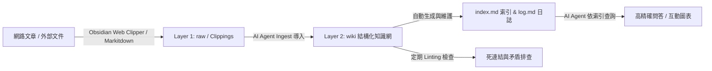

---
{"categories":"wiki","tags":["wiki","wiki/ai","wiki/pkm","wiki/obsidian"],"status":"🌞","sourceType":"📥/✨","created":"2026-09-24T14:09:15.239+08:00","updated":"2026-11-25T21:20:13.059+08:00","summary":"Andrej Karpathy 提出的 LLM-Wiki 三層架構、本地知識導入 Agent 系統之實務價值、Antigravity 六步實作流程、Obsidian 自動化與對比傳統 RAG 的高效知識編譯模式。","tier":"core","base_confidence":0.85,"lifecycle":"draft","sources":["[[Clippings/Antigravity + 微軟 Markitdown Skill + Karpaty LLM Wiki 測試知識管理.md]]","[[Clippings/Antigravity 實做 Karpathy LLM Wiki.md]]","[[Clippings/用 LLM wiki 將本地知識導入Agent系統，以提升其專業性與實務可用性.md]]","[[Clippings/國外瘋傳的 AI 筆記工作流！LLM Wiki 讓你的 Obsidian 筆記升級成能自我進化的第二大腦！.md]]"],"dg-publish":true,"permalink":"/wiki/LLM_Wiki_知識庫架構/","dgPassFrontmatter":true,"noteIcon":"","dg-note-properties":{"categories":"wiki","tags":["wiki","wiki/ai","wiki/pkm","wiki/obsidian"],"status":"🌞","sourceType":"📥/✨","created":"2026-09-24","updated":"2026-11-23","summary":"Andrej Karpathy 提出的 LLM-Wiki 三層架構、本地知識導入 Agent 系統之實務價值、Antigravity 六步實作流程、Obsidian 自動化與對比傳統 RAG 的高效知識編譯模式。","tier":"core","base_confidence":0.85,"lifecycle":"draft","sources":["[[Clippings/Antigravity + 微軟 Markitdown Skill + Karpaty LLM Wiki 測試知識管理]]","[[Clippings/Antigravity 實做 Karpathy LLM Wiki]]","[[Clippings/用 LLM wiki 將本地知識導入Agent系統，以提升其專業性與實務可用性]]","[[Clippings/國外瘋傳的 AI 筆記工作流！LLM Wiki 讓你的 Obsidian 筆記升級成能自我進化的第二大腦！]]"]}}
---


# LLM-Wiki 知識庫架構與第二大腦工作流

本頁面彙整並解析由 AI 學者 [[Notes/Andrej Karpathy\|Andrej Karpathy]] 提出的 **LLM-Wiki** 知識編譯架構，結合清華大學 [[Notes/孫天龍\|孫天龍]] 教授關於「本地私有知識導入 Agent 系統」與「LLM-Wiki 對比傳統 RAG 效能」的實證研究，以及 [[Notes/PAPAYA 電腦教室\|PAPAYA 電腦教室]] 的 Obsidian 全流程落地指南，深入探討如何運用 AI 代理人打造自我進化的「第二大腦」。

---

## 1. Andrej Karpathy 的 LLM-Wiki 核心理念

在生成式 AI 與個人知識管理（PKM）的交匯點上，傳統知識庫面臨「維護成本過高」與「隨時間腐爛」的困境。Andrej Karpathy 提出了全新的架構思維：

* **核心分工原則**：
  > **「人類負責提供原始資料與提問，AI 負責閱讀、編譯與維護知識庫。」**
* **持久且複合成長的編譯產物（Compounding Knowledge Base）**：
  * LLM-Wiki 不是單純的問答 Chatbot，而是一座**預編譯的結構化知識網**。
  * 每次匯入新資訊，AI 不僅是摘要單篇文獻，而是將新觀點「編譯」並融合進既有的概念、實體與脈絡中，讓知識庫隨時間產生「知識複利」。
* **告別手動維護的認知負擔**：
  * 傳統 Obsidian 用戶需手動建立雙向連結、整理標籤、維護關聯圖（Graph View），久而久之維護負擔超過筆記本身的價值。
  * 在 LLM-Wiki 工作流中，人類回歸「策展人（Curator）」角色，繁重的信息提取、交叉引用、索引生成與矛盾排查全數交由 AI Agent 執行。

---

## 2. LLM-Wiki 三層架構 (Three-Layer Architecture)

LLM-Wiki 採用嚴謹的職責分離三層架構：

```
LLM-Wiki 三層架構
├── Layer 1: Raw Sources（不可變原始素材）
│   ├── raw/ (書籍、學術論文、PDF、圖片、教學指引)
│   └── Clippings/ (Web Clipper 網路剪藏文章)
│
├── Layer 2: Compiled Wiki（AI 維護的結構化知識庫）
│   ├── wiki/ (概念 Concept、實體 Entity、專題 Synthesis)
│   ├── index.md (全域內容目錄索引，供 AI 快速檢索定位)
│   └── log.md (追加式操作日誌，確保可溯源與防重複)
│
└── Layer 3: Schema & Rules（Agent 運作規則手冊）
    └── agent.md (或 CLAUDE.md / AGENTS.md 指導手冊)
```

### 2.1 Layer 1：原始文獻層 (Raw Sources — 唯讀不可變)
* **位置**：`/raw/` 與 `/Clippings/`。
* **特性**：對 AI 而言是**完全唯讀 (Read-only)** 且**不可變 (Immutable)** 的真實憑證（Ground Truth）。包含 PDF、Markdown、HTML、網頁剪藏與圖片。
* **原則**：永遠保留一手原始資訊，作為未來重新編譯、溯源查核的依據。

### 2.2 Layer 2：編譯知識層 (The Wiki — AI 完全讀寫)
* **位置**：`/wiki/`。
* **特性**：由 AI Agent 自主生成、更新與交叉連結的結構化知識卡片。
* **內容規格**：
  * 規範的 YAML Frontmatter（包含分類、標籤、建立日期、來源 sources 追蹤）。
  * 密集的 Obsidian `[[雙向連結]]`，形成高內聚的神經網絡。
  * 流暢平實的白話寫作，條理清晰地闡述脈絡。

### 2.3 Layer 3：規則手冊層 (The Schema — 系統憲法)
* **位置**：`/agent.md`（依工具不同可為 `CLAUDE.md` 或 `AGENTS.md`）。
* **核心規範**：
  * **目錄與權限約定**：嚴禁 AI 擅自刪改使用者的個人筆記（如 PARA 系統），僅能在 `/wiki/` 與日誌中作業。
  * **工作流規範**：嚴格定義 Ingest（導入）、Query（查詢）、Lint（健康檢查）的操作步驟。
  * **寫作風格指南**：規定白話風格、雙向連結密度與矛盾標記（`> [!WARNING]`）機制。

### 2.4 系統中樞：目錄索引與歷史日誌
* **`index.md` (全域內容索引)**：
  * 記錄知識庫中所有概念與實體頁面的單行摘要與來源映射。
  * 這是 AI Agent 執行查詢時的第一站，使 Agent 在極低 Token 成本下迅速定位關聯筆記，無需全文檢索全庫。
* **`log.md` (追加式操作日誌)**：
  * 記錄每次導入、更新與維護的時間、來源文件與產出頁面。
  * 避免重複匯入相同資料，並提供完整的演化歷史回溯。

---

## 3. LLM-Wiki vs. 傳統 RAG 系統比較（孫天龍實證）

清華大學 [[Notes/孫天龍\|孫天龍]] 教授在進行知識管理實測時，對比了傳統 RAG 與現代 Agent + LLM-Wiki 工作流的差異：

| 評比維度 | 傳統 RAG 系統 (如 n8n + 向量資料庫) | LLM-Wiki (Antigravity + Markitdown + Agent) |
| :--- | :--- | :--- |
| **開發與建置時間** | 需花費數週至**數個月**調校 Pipeline、分塊（Chunking）與檢索策略 | 依循 LLM-Wiki 模式與 Agent Skill，**不到 15 分鐘**即可完成知識庫初始化與導入 |
| **知識完整性** | 基於向量相似度檢索碎片，容易產生**斷章取義**或遺漏跨章節脈絡 | 透過 AI **整體閱讀後編譯**，知識被消化吸收為脈絡完整的概念文章 |
| **回答精確度** | 容易受檢索 Top-K 品質影響，在專門領域容易產生幻覺 | 答案更精準、邏輯更連貫，且具備明確的文獻與段落來源追溯 |
| **架構複雜度** | 需額外維護向量資料庫（Vector DB）、Embedding 模型與複雜的中介軟體 | 基於純文字 Markdown 與 Obsidian 檔案系統，**零外部資料庫依賴**，便攜可控 |

---

## 4. 本地私有知識導入 Agent 系統：實務可用性躍升

通用大語言模型（如 GPT-4、Claude 3.7、Gemini 2.5）雖然具備廣泛的常識與推理能力，但面對特定組織或專業領域時仍有致命盲點：

1. **關鍵知識的不可取得性**：多數企業核心技術、行政規章、專案歷史與個人專門知識屬於私有隱性知識，絕不可能存在於網路公開訓練語料中。
2. **通用知識無法解決特定情境**：沒有內部脈絡的 AI 只能給出「看似正確但無法落地」的空泛建議。
3. **解決之道：以 LLM-Wiki 作為 Agent 的專屬工作現場（Workspace）**：
   * 將私有文件放入 `raw/`，透過 Agent 自動編譯成 LLM-Wiki。
   * Agent 執行任務時，先由 `index.md` 與特定 `wiki/` 頁面載入深度的背景知識與操作規範。
   * 此架構使 Agent 兼具「通用推理大腦」與「專屬領域知識庫」，大幅提升在企業內部與專業實務中的可用性與可信度。

---

## 5. Obsidian + AI Agent 的全流程落地工作流

依據 [[Notes/PAPAYA 電腦教室\|PAPAYA 電腦教室]] 的實踐示範，打造自我進化的第二大腦包含以下關鍵流程：



### 5.1 資料擷取與前處理
* **Obsidian Web Clipper**：配置瀏覽器擴充功能，設定儲存路徑為 `Clippings/` 或 `raw/`，閱讀優質文章時一鍵完整擷取內文與來源網址。
* **微軟 Markitdown 工具**：利用 `markitdown` 命令列工具，秒級將 PDF、Word、PPT 或 Excel 文件轉換為純淨 Markdown，完美填補異質文件進入知識庫的落差。

### 5.2 導入編譯 (Ingest Workflow)
1. 使用者將文章存入 `raw/` 或 `Clippings/`，下達 `Ingest` 指令。
2. Agent 讀取新文件，提取核心論點、新概念、關鍵人物與歷史事件。
3. Agent 查閱 `index.md`：
   * 若涉及既有概念，則將新內容融合進該頁面，豐富論述並保留脈絡。
   * 若發現全新概念，則於 `/wiki/` 下建立新頁面，並建立雙向連結。
4. Agent 更新 `index.md` 索引與 `log.md` 日誌。

### 5.3 智慧查詢與知識沉澱 (Query & Synthesis)
* Agent 回答提問時，遵循「**先查 index 定位 $\rightarrow$ 閱讀特定 wiki 頁面 $\rightarrow$ 標註雙向連結來源**」流程。
* 若問答中產出極具價值的分析或比較矩陣，Agent 主動提議將其沉澱為新 Wiki 頁面，實踐知識的自我生長。

### 5.4 系統健康檢查 (Linting Workflow)
* **死連結檢查**：排查指向不存在檔案的無效連結。
* **孤立頁面排查 (Orphans)**：找出未被任何頁面或目錄連結的落單筆記。
* **矛盾與衝突檢測**：若兩份原始文獻說法不一，在頁面中顯式標記 `> [!WARNING] 矛盾警告`。

### 5.5 視覺化延伸 (HTML 資訊圖表)
* 除了文字筆記，Agent 還能將 Wiki 內容進一步編譯為互動式網頁與圖表（例如三國戰役時間軸、脈輪動態圖解），使靜態知識庫轉化為生動的可視化探索工具。

### 5.6 Google Antigravity 實作自演化知識庫六步驟（孫天龍示範）
[[Notes/孫天龍\|孫天龍]] 教授（[[Notes/Tien-Lung Sun\|Tien-Lung Sun]]）在示範影片中，具體拆解了如何以 **Antigravity** 落地 [[Notes/Andrej Karpathy\|Andrej Karpathy]] 的 LLM-Wiki 理念，建立一套**自演化知識庫（Self-evolving Knowledge Base）**的六大標準步驟：
1. **系統建置**：直接請 AI Agent 依據 Andrej Karpathy 的核心想法，設計並開發 LLM-Wiki 的目錄架構與操作規則（Schema）。
2. **異質資料轉檔**：調用微軟 `markitdown` skill，將 PDF、簡報、文件等各種格式的原始素材轉換為純文字 Markdown 檔案。
3. **Data Ingest（知識注入）**：由 Agent 讀取轉換後的 Markdown，進行提煉、融合並編譯至 Wiki 知識頁面。
4. **Obsidian 視覺化（Visualize）**：透過 Obsidian 瀏覽編譯後的筆記內容與雙向連結圖譜，掌握知識脈絡。
5. **Query（知識查詢）**：利用索引與結構化頁面進行精準的跨文件問答與綜合推論。
6. **Linting（KB 維護）**：定期由 Agent 掃描與整理知識庫，確保連結有效、結構清晰並持續隨新知識演進。

---

## 相關頁面
* [[wiki/Obsidian_高效工作流\|Obsidian_高效工作流]]
* [[wiki/AI_與學習科技\|AI_與學習科技]]
* [[Notes/Andrej Karpathy\|Andrej Karpathy]]
* [[Notes/孫天龍\|孫天龍]]
* [[Notes/PAPAYA 電腦教室\|PAPAYA 電腦教室]]
* [[agent\|agent.md]]
