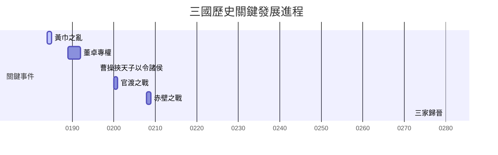

---
{"categories":"wiki","tags":["wiki","wiki/sanguo"],"status":"🌱","sourceType":"📥/✨","created":"2026-07-15T17:18:40.664+08:00","sources":["[[raw/三國志/一口氣看完三國志.md]]"],"dg-publish":true,"permalink":"/wiki/三國志_歷史簡表/","dgPassFrontmatter":true,"noteIcon":"","updated":"2026-11-26T16:18:03.341+08:00","dg-note-properties":{"categories":"wiki","tags":["wiki","wiki/sanguo"],"status":"🌱","sourceType":"📥/✨","created":"2026-07-15","sources":["[[raw/三國志/一口氣看完三國志]]"]}}
---

# 三國志 Wiki 歷史簡表

本頁面以時間軸與戰略轉折點為核心，梳理東漢末年至西晉統一的宏大歷史進程。

## 歷史發展時間軸

1. **起點：[[Notes/黃巾之亂\|黃巾之亂]] (西元184年)**：天災瘟疫、朝政腐敗下爆發的大規模民變，促成地方豪強擁兵自重，拉開割據序幕。
2. **亂政：[[Notes/董卓\|董卓]] 專權 (西元189-192年)**：趁戚宦之爭進入洛陽執政，廢少帝立獻帝，後被 [[Notes/呂布\|呂布]] 與王允刺殺。
3. **擴張：天子牌的運用 (西元196年)**：[[Notes/曹操\|曹操]] 實施「[[wiki/挾天子以令諸侯\|挾天子以令諸侯]]」，遷都許縣，搶佔道德制高點。
4. **爭霸：[[Notes/官渡之戰\|官渡之戰]] (西元200年)**：曹操以少勝多擊敗 [[Notes/袁紹\|袁紹]]，基本統一北方。
5. **對峙：[[Notes/赤壁之戰\|赤壁之戰]] (西元208年)**：[[Notes/劉備\|劉備]] 與 [[Notes/孫權\|孫權]] 結盟大敗曹操，奠定三國鼎立基礎。
6. **終局：三家歸晉 (西元280年)**：司馬家族篡奪曹魏權力，並相繼消滅蜀、吳，結束分裂局面。

---

## 相關頁面
* [[wiki/三國志_三大勢力\|三國志_三大勢力]]
* [[wiki/挾天子以令諸侯\|挾天子以令諸侯]]
