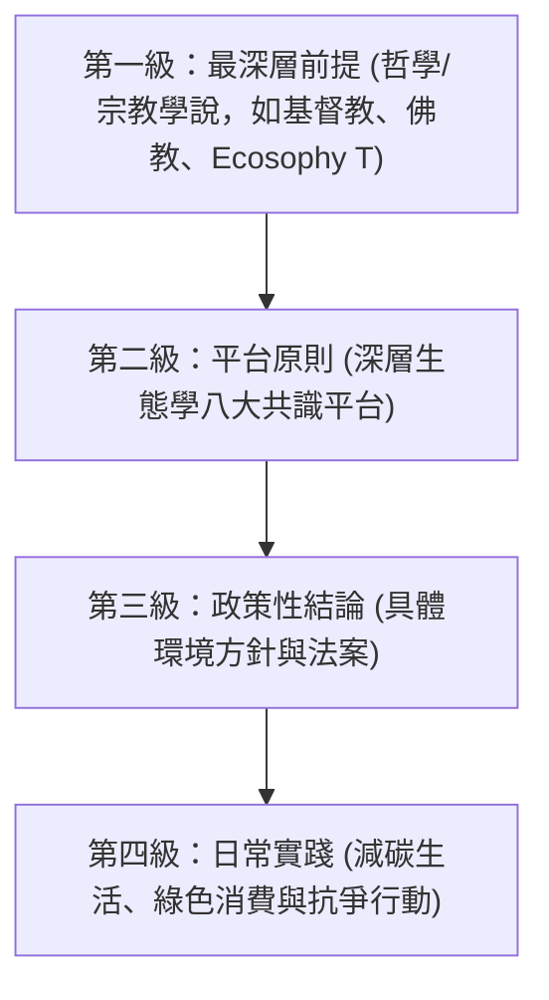

---
{"categories":"wiki","tags":["wiki","wiki/ecology","wiki/philosophy"],"status":"🌞","sourceType":"📥/✨","created":"2026-07-15T20:54:45.260+08:00","updated":"2026-11-25T19:12:02.084+08:00","sources":["[[raw/Naess 深層生態學研究-論文.pdf]]","[[raw/Naess 深層生態學研究-論文.md]]"],"dg-publish":true,"permalink":"/wiki/深層生態學_八大平台原則/","dgPassFrontmatter":true,"noteIcon":"","dg-note-properties":{"categories":"wiki","tags":["wiki","wiki/ecology","wiki/philosophy"],"status":"🌞","sourceType":"📥/✨","created":"2026-07-15","updated":"2026-07-15","sources":["[[raw/Naess 深層生態學研究-論文.pdf]]","[[raw/Naess 深層生態學研究-論文]]"]}}
---

# 深層生態學 八大平台原則

本頁面介紹深層生態學運動的共識平台「八大平台原則（Deep Ecology Platform）」，以及 [[Notes/阿恩·奈斯\|阿恩·奈斯]] 用以釐清邏輯層次的「圍裙圖（Apron Diagram）」。

## 1. 圍裙圖 (Apron Diagram) 的四級邏輯
奈斯設計了圍裙圖，用以說明不同宗教或哲學背景的人如何能在環境運動中達成共識：

* **特點**：在第一級，人們可以有完全不同的信仰前提，但只要認同第二級的「平台原則」，便能在第三、四級採取共同的生態行動。

---

## 2. 八大平台原則 (The Eight-point Platform) 與奈斯註解

奈斯與 George Sessions 共同起草了八大平台原則，作為深層生態學支持者的共同基礎。以下是每一項原則及其背後的詳細哲學註解與評論：

### 1. 內在價值 (Intrinsic Value)
> **地球上人類與非人類生命的福祉與繁榮，本身就具有內在價值（或稱固有價值），與人類的效用無關。**
* **奈斯註解**：
  * 此原則指的是整個「生態圈 (Ecosphere)」（包含個體、物種、種群、棲地以及人類與非人類文化）的整體價值（生態中心主義）。
  * 「生命」一詞在此是以廣義、非技術性的方式使用，涵蓋了無生命的河流、地景與整個生態系統（如「讓河流活著 Let river live」的口號）。
  * 自然物的內在價值獨立於任何意識主體之認知、利益或欣賞。

### 2. 多樣性價值 (Value of Diversity)
> **生命形式的豐富性與多樣性有助於這些價值的實現，其自身亦是價值。**
* **奈斯註解**：
  * 所謂簡單、低等或原始的物種，在本質上對生命的豐富性與多樣性有著極大的貢獻，牠們擁有自己的價值，而非僅為了「更高或理性的生命形式」之繁盛而存在。
  * 此原則預設了生命自身的進化過程隱含著豐富性與多樣性的增加。
  * 這裡指的「複雜性 (Complexity)」並不等於城市生活中的「混亂 (Complication)」（例如：自然生活比城市生活更複雜，但城市生活比自然生活更混亂）。

### 3. 人類無權減少 (No Right to Reduce)
> **除了維生的基本需求，人類沒有權利減少生命形式的豐富性與多樣性。**
* **奈斯註解**：
  * 奈斯刻意將**「基本需求 (Vital need)」**一詞保留模糊空間，以便在具體情境下允許較多的自由判斷。
  * 判斷時，必須考量不同氣候環境之差異，以及現存社會結構之差異。

### 4. 人口適度 (Population Adequacy)
> **人類生命和文化的蓬勃發展與較少的人口數量相容，且非人類生命的蓬勃發展需要較少的人口數量。**
* **奈斯註解**：
  * 我們不能期望物質富裕國家的人們在一夜之間減少他們對非人類世界的干預，人口穩定與減少需要數百年的時間，因而必須發展暫時性對策。
  * 除非實現深層改變，否則豐富性與多樣性的急劇減少將產生嚴重後果——物種滅絕的速度將比地球歷史上的任何時期快 10 到 100 倍。

### 5. 人類干涉過度 (Excessive Human Interference)
> **目前人類已過度干擾非人類世界，且情況快速惡化。**
* **奈斯註解**：
  * 「非干擾 (Non-interference)」並不意味著人類完全不能像其他物種一樣改變 (Modify) 生態系統，關鍵在於干涉的「性質」和「程度」。
  * 在富裕國家中，每人平均對荒野與生態系統的破壞量是過度的，貧窮國家切勿模仿。
  * 目前大多數荒野地區的規模已不足以孕育物種的自然演化，必須全力保存並擴大荒野。

### 6. 改變政策 (Policy Change)
> **各種政策因而必須改弦更張；這些新政策將會影響經濟的、科技的及意識型態的基本結構，而導致與現狀完全不同的社會秩序。**
* **奈斯註解**：
  * 目前工業國家實施的盲目經濟增長政策與前五條原則是不相容的，商品化與過度消費必須被扭轉。
  * 雖然提倡在地行動，但深層改變的實現需要跨國界的全球行動。
  * 當第三世界政府因體制問題無法落實生態措施（如沙漠化治理）時，透過非政府國際組織 (NGO) 推動全球行動越發重要。

### 7. 生活質量 vs 生活標準 (Quality of Life)
> **意識型態的改變主要在於以欣賞「生命品質 (Quality of Life)」取代追求越來越高的「物質生活標準 (Standard of Living)」，深刻意識到「大 (Bigness)」與「崇高 (Greatness)」的不同。**
* **奈斯註解**：
  * 「生命品質」一詞指非量化的 (Nonquantitative) 性質，我們無法、亦無必要精確量化生命品質。

### 8. 行動責任 (Obligation to Act)
> **認同上述原則者，有義務直接或間接參與並嘗試推動這些必要的改革。**
* **奈斯註解**：
  * 環境危機的問題高度多樣化，每個人都可以在其中找到適合自己的層面與方式來解決（無論是直接的行動或間接的支持）。

---
Path: wiki/深層生態學_八大平台原則.md
